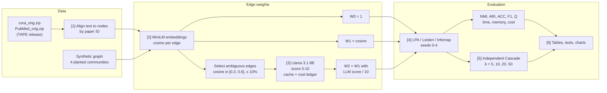

# Chapter 2. Project design and methodology

## 2.1 System overview

The system is a Python batch pipeline with six steps, one module each under `src/`. `src/run_pipeline.py` (or `make all`) runs them in order. All settings are in `src/config.py`.

| Step | Module | What it does | Main output |
|---|---|---|---|
| 1. Data | `load_data.py` | Downloads the archives, checks SHA-256, joins text to nodes by paper ID, builds the synthetic graph | `data/processed/*`, `outputs/data_manifest.json` |
| 2. Edge weights | `edge_weights.py` | MiniLM embeddings, cosine per edge (W1), picks the edges the LLM will re-score | `data/processed/*_cos.npy`, `outputs/embedding_log.json` |
| 3. LLM scoring | `llm_scoring.py` | Asks Llama 3.1 8B for a 0-10 score per selected edge, caches and costs every call | `outputs/llm/calls.jsonl`, `outputs/llm/scores/*.csv` |
| 4. Detection | `detect.py` | LPA, Leiden, Infomap × 5 seeds × every weight variant; computes all metrics | `outputs/runs.csv` |
| 5. Downstream | `diffusion.py` | Independent Cascade spread from community-based and degree-based seeds | `outputs/diffusion.csv` |
| 6. Report | `make_charts.py` | Tables, significance tests, charts | `outputs/tables/`, `outputs/charts/`, `outputs/significance.csv` |

## 2.2 System architecture



**Figure 2.1: Pipeline architecture. Labels are used only inside "Evaluation".**

## 2.3 Base paper and comparison strategy

The course guide (Section 5) asks for a base paper whose datasets and metrics the project follows. This project follows the guide's own Topic 2 execution plan (Section 9), on the datasets it names.

| Item | Choice | Reason |
|---|---|---|
| Data reference | TAPE, He et al., ICLR 2024 [13] | Provides the original Cora and PubMed text with matching IDs (code: github.com/XiaoxinHe/TAPE) |
| Metrics | NMI, ARI, ACC (Hungarian), macro-F1, modularity | Guide Section 6.1 and Section 9 list for Topic 2 |
| Baselines | W0 and W1 with LPA, Leiden, Infomap; W2 with random edges | Run by us under one protocol (guide Option A). Leiden is always included, as the guide recommends |
| Not imported | TAPE accuracy, ComGPT and CommLLM scores | Different tasks (supervised classification, local community search, whole-graph prompting); importing them would break the guide's Option B conditions |
| Fallback base paper | CDBNE, ESWA 2023 [9] | Closest unsupervised method on Cora and PubMed, if the instructor requires a published clustering baseline |

## 2.4 Datasets

| Dataset | Nodes | Edges | Classes | Text | Source |
|---|---|---|---|---|---|
| Cora | 2,708 | 5,278 | 7 ML subfields | Title + abstract (2,373 both, 293 title only, 42 abstract only) | TAPE release of the McCallum Cora corpus [7], [13] |
| PubMed | 19,716 | 44,323 | 3 diabetes types | Title + abstract | TAPE release of PubMed-Diabetes [7], [13] |
| Synthetic | 400 | 2,682 | 4 planted | 12 words from the community's topic list | Stochastic block model, p_in = 0.08, p_out = 0.02 (guide Section 7.3) |

**Preprocessing (identical for every method):** citations made undirected; self-loops and duplicates removed; all nodes kept. One PubMed paper (PMID 17874530) has no title or abstract and is removed with its one edge. Class labels are never used by the method; they are read only to compute NMI, ARI, ACC and F1.

**Text alignment.** The reference loader in the TAPE repository pairs PubMed text with nodes *by row position*. The text file has one record without a PMID at row 2,459, so every following row would get the wrong paper. Its Cora loader also keeps the previous paper's abstract when a paper has none. Our loader joins both datasets by paper ID and uses only each paper's own text.

## 2.5 Proposed method

### 2.5.1 Edge weights

For a graph G = (V, E) where each node v has text t(v):

* **W0 (structure only):** w(u, v) = 1.
* **W1 (embedding):** w(u, v) = max(cos(e(u), e(v)), ε), where e(·) is the L2-normalised `all-MiniLM-L6-v2` embedding [6], [22] and ε = 10⁻⁶ keeps weights positive.
* **W2 (selective LLM):** w(u, v) = W1, except for the selected set S, where w(u, v) = max(s(u, v) / 10, ε) and s(u, v) ∈ {0, …, 10} is the LLM's score.

### 2.5.2 Choosing which edges the LLM sees

An edge is *ambiguous* if its cosine is in the band [a, b] = [0.3, 0.6] from the course guide. Edges far below are clearly unrelated and edges far above are clearly related, so the embedding is trusted there. The budget is B = round(β · |E|) with β = 10%: Cora 528 edges, PubMed 4,432. Ambiguous edges are sorted by distance from the band midpoint (a + b) / 2 and the first B are taken. The rule is fixed before any label is looked at.

### 2.5.3 The LLM call

Model: `meta-llama/llama-3.1-8b-instruct` [23] through OpenRouter, pinned to the DeepInfra fp8 endpoint with fallback disabled, temperature 0, at most 8 output tokens. Each paper's text is cut to its first 600 characters. The prompt is the guide's wording (Appendix A.1). Only a whole number from 0 to 10 is accepted. Any other answer is recorded as *invalid*; a network error is recorded as *failed*. In both cases the edge keeps its W1 weight. Every attempt is written to a ledger with tokens, cost, latency and the provider that served it, and identical requests are answered from the cache. Calls stop at a $1.00 ceiling.

### 2.5.4 Pseudocode

```text
Algorithm 1: Budgeted LLM edge re-weighting (W2)
Input : graph G = (V, E), texts t(v), band [a, b], budget fraction β, LLM f
Output: edge weights w

 1  for each v in V:  e(v) ← normalise(MiniLM(t(v)))            # once, cached
 2  for each (u, v) in E:  c(u, v) ← e(u) · e(v)                 # cosine
 3  w(u, v) ← max(c(u, v), ε)                                     # W1
 4  A ← { (u, v) in E : a ≤ c(u, v) ≤ b }                          # ambiguous edges
 5  S ← first round(β|E|) edges of A sorted by |c(u, v) − (a+b)/2|, then edge id
 6  for each (u, v) in S, in parallel:
 7      if cache has (u, v): s ← cache[(u, v)]
 8      else if spent ≥ ceiling: stop
 9      else s ← f(prompt(t(u)[:600], t(v)[:600])); log tokens, cost; cache
10      if s is an integer in [0, 10]:  w(u, v) ← max(s / 10, ε)   # else keep W1
11  return w

Algorithm 2: Evaluation
for variant in {W0, W1, W2, ablations}:  for detector in {LPA, Leiden, Infomap}:
    for seed in 0..4:  P ← detector(G, w_variant, seed);  record NMI, ARI, ACC, F1, Q(G, P), time
```

### 2.5.5 Complexity

Let n = |V|, m = |E|, d = 384 (embedding size), B = budget.

| Part | Time | Notes |
|---|---|---|
| Embeddings | O(n · L) transformer passes, L ≤ 256 tokens | Once per dataset, cached |
| Cosine for all edges | O(m · d) | Under a second |
| Edge selection | O(m log m) | Sort |
| LLM calls | O(B) API calls | The real cost; B ≤ 0.1 m |
| LPA | about O(m) per iteration | Few iterations in practice [2] |
| Leiden | about O(m) per iteration [5] | |
| Infomap | about O(m) per trial × 10 trials [3] | |
| Independent Cascade | O(R · (n + m)) for R = 200 simulations | Live-edge connected components |

The LLM is the only part whose cost grows with money, so the budget B is the main knob.

## 2.6 Detectors (baselines and method use the same three)

| Detector | Library | Settings |
|---|---|---|
| Asynchronous label propagation [2] | NetworkX [25] `asyn_lpa_communities` | weight = edge weight, seed = run seed |
| Leiden [5] | igraph [24] `community_leiden` | objective = modularity, iterate until stable, Python RNG seeded |
| Infomap [3] | igraph `community_infomap` | edge weights, 10 trials, Python RNG seeded |

## 2.7 Evaluation metrics

Let y be the true classes and ŷ the detected communities.

| Metric | Definition | Needs labels |
|---|---|---|
| NMI | I(y; ŷ) / ((H(y) + H(ŷ)) / 2), arithmetic normalisation [28] | Yes |
| ARI | Rand index adjusted for chance [26] | Yes |
| ACC | Accuracy after the best one-to-one matching of communities to classes (Hungarian algorithm); unmatched communities count as wrong | Yes |
| Macro-F1 | F1 after the same matching, averaged over the true classes | Yes |
| Q | Modularity of ŷ on the **original unweighted** graph, so W0, W1 and W2 are compared on one scale | No |
| Communities | Number of communities found | No |
| Cost | LLM calls, tokens, USD (as reported by OpenRouter), latency | No |
| Resources | Detector wall time; peak process memory | No |

The guide's starter code averages macro-F1 over every label it sees, so each extra small community would add a class with F1 = 0. We average over the true classes only (Decision D14).

## 2.8 Experimental protocol

| Item | Setting |
|---|---|
| Seeds | 0, 1, 2, 3, 4 for every detector run; seed logged in every row |
| Main comparison | 2 datasets × 3 variants × 3 detectors × 5 seeds = 90 runs |
| Ablation | W2 with random edges (same number of calls), bands [0.2, 0.5] and [0.4, 0.7], prompt "topic" (Cora), Llama 3.1 70B (Cora) |
| Sensitivity | Budget 5%, 10%, 20% |
| Sanity check | Synthetic graph: W0, W1, W2, all detectors, 5 seeds |
| Significance | Wilcoxon signed-rank [27], paired by (dataset, detector, seed); per cell n = 5 and pooled n = 30; effect size = matched-pairs rank-biserial correlation |
| Downstream | Independent Cascade [1], p = 0.05, k ∈ {5, 10, 20, 50}, 200 simulations; seeds from W0 / W1 / W2 Leiden communities (seed 0) vs top-k degree |
| Tuning | None. Band, budget and prompt come from the guide and are fixed before evaluation. Labels never influence the method |
| LLM reuse | One cached answer per edge, reused by all detectors and seeds |

**A note on the tests.** With 5 paired runs, the smallest two-sided p-value the Wilcoxon test can give is 2/32 = 0.0625. A per-cell test can therefore never reach p < 0.05. The pooled test over 30 pairs was declared before the results were seen, and effect sizes are always reported.

**Fair downstream comparison.** Independent Cascade on an undirected graph is equivalent to keeping each edge "live" with probability p and activating everything connected to a seed through live edges. The 200 live-edge samples are drawn once and shared by every strategy, and every strategy gets exactly k distinct seeds. The diffusion graph is the original graph for all strategies, so only the choice of seeds differs.

## 2.9 Risks and fallback plan

| Risk | Fallback |
|---|---|
| OpenRouter endpoint unavailable | Failed calls are logged and retried; edges keep W1 weights; the provider can be changed in `config.py` and is reported |
| Cost overrun | Hard ceiling of $1.00; cache prevents paying twice |
| LLM answers not a number | Recorded as invalid, keeps W1, counted in the cost table |
| W2 does not beat W1 | Reported as a valid negative result with its cost |
| Instructor requires a published base paper | CDBNE [9] on Cora and PubMed with the same metrics |
